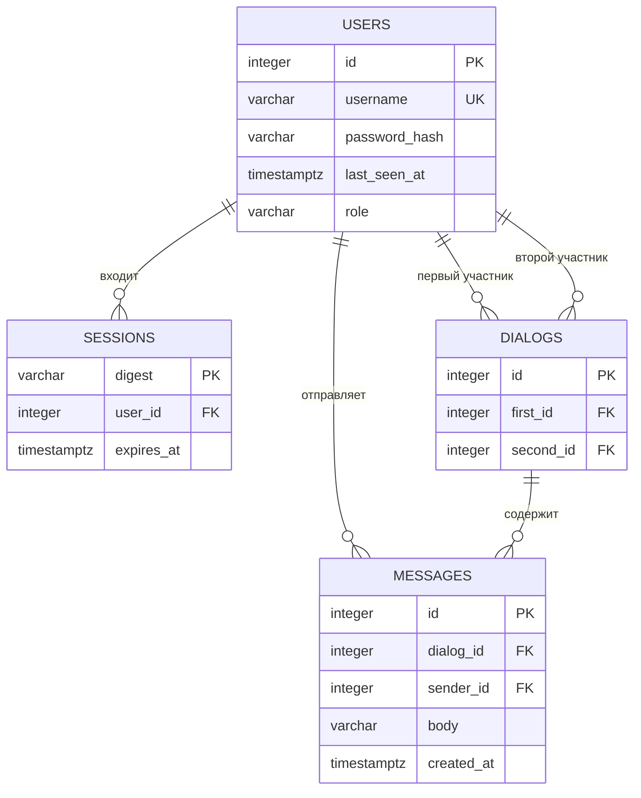

# Схема PostgreSQL

| Таблица | Ограничения и запросы |
|---|---|
| users | Имя 3–32 символа, БД допускает только строчные ASCII-буквы, цифры и `_`. Уникальный индекс обеспечивает вход по имени. CHECK для роли, по умолчанию `user`. |
| sessions | Первичный ключ — 64 шестнадцатеричных символа SHA-256. Индексы на владельце и сроке действия. При выходе строка удаляется, при входе очищаются истёкшие сессии. |
| dialogs | Оба внешних ключа обязательны. CHECK `first_id < second_id` задаёт канонический порядок. UNIQUE на паре и INSERT ON CONFLICT предотвращают дубли при одновременном создании. Первый столбец покрыт индексом пары, на втором есть отдельный индекс. |
| messages | Длина 1–4000, обязательные внешние ключи, время `timestamptz DEFAULT now()`. Индекс `(dialog_id, id)` используется для выборки последней записи и истории по курсору. Авторство участника проверяет сервис в транзакции. |

Если активность ещё не наблюдалась, last_seen_at равен NULL. При обновлении старой базы миграция берёт последнее известное время отправки сообщения или начала сохранённой семидневной сессии. Остальные поля обязательны. Диалог хранит одну неупорядоченную пару в канонической форме. Имена и роли находятся только в users, участники — в dialogs. Текст и автор каждого сообщения записаны однократно. Превью последнего сообщения вычисляется запросом с LATERAL. Порядок истории задаёт монотонный идентификатор внутри диалога. Перед вставкой сервис берёт блокировку строки диалога, поэтому при параллельной отправке порядок выделения идентификаторов согласован с порядком фиксации.
